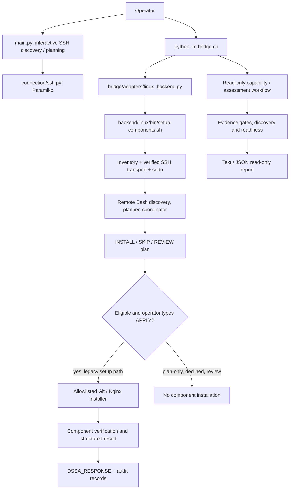

# Developer Server Setup Assistant (DSSA)

Agentless Linux server discovery, readiness assessment and selectively approved component setup, developed as a DevOps engineering project. **V1 is unfinished and is not recommended for production use.**

> **Source-of-truth snapshot:** published `architecture/layered-platform` commit `46f8637339255b8b2fac1e3a6a2e1f72071197cd` (12 November 2026). The operator's subsequent, uncommitted Milestone 4.29 Docker work is separately documented in [PROJECT_STATE](docs/PROJECT_STATE.md), not represented as published application code.

## Problem and intended use
Developers often receive a bare Linux server but need system discovery, SSH/sudo verification, conflict-aware component preparation, swap assessment and deployment readiness before deploying their own applications. DSSA aims to guide that work without deploying the application itself.

## What is verified today?

| Capability | Evidence / boundary |
|---|---|
| Agentless SSH connection, sudo and system discovery | Implemented in the Python interactive flow and Linux backend; lab and break/fix exercises documented |
| OS/kernel/CPU/RAM/disk/swap, panel and component discovery | Implemented; aaPanel detection demonstrated in lab |
| Read-only lifecycle and Docker/Compose assessment | Published through Milestones 4.10–4.27; 523/523 tests at 4.27 and 24/24 six-VM assessment checks |
| Package-manager-first Git setup | **Live installed** on Debian 13 (APT, Git 2.47.3) and AlmaLinux 10 (DNF, Git 2.52.0), with second-run SKIP and verification; 533/533 tests at 4.28 |
| Existing Nginx handling | Earlier live checks of installed-package and HTTP readiness; **fresh Nginx installation not established as validated** |
| Docker Engine installation | Published read-only draft recipe only. A separate *uncommitted* Ubuntu 24.04 Bash installer is being tested; **not installed live through DSSA** |
| Docker Compose installation | Read-only draft and runtime detection; no approved live installation |
| Swap creation/activation | Not verified as a completed end-to-end execution workflow |
| Panels such as CyberPanel/HestiaCP | Future work, not functional installers |

The application catalog includes 23 definitions. A catalog entry or draft recipe **does not** mean it is installable.

## Actual architecture



The read-only assessment workflow cannot authorize the legacy installation runner. The diagram reflects the **published** branch; unpublished Docker modifications are documented separately.

## Repository entry points

- `main.py`: interactive SSH, discovery, compatibility and non-executable approval demonstration.
- `bridge/cli.py`: `--target ... --component ... [--plan]`, `assess` and `capabilities` CLI routes.
- `bridge/adapters/linux_backend.py`: bridges component CLI to the backend runner.
- `backend/linux/bin/setup-components.sh`: inventory-backed SSH transport, remote bundle, audit and framed response.
- `backend/linux/planning/components.sh`: fixed component mapping, `INSTALL`/`SKIP`/`REVIEW` planning.
- `backend/linux/operations/setup.sh`: plan display, `APPLY` gate, execution dispatch, result validation and partial failure reporting.
- `backend/linux/modules/install/`: Git/Nginx component-specific installation helpers.
- `backend/linux/verification/`: Git/Nginx checks.
- `bridge/applications/`: application definitions, evidence, draft recipes and read-only readiness.
- `tests/backend/`: unit, contract, transport, planning and regression tests.
- `docs/`: detailed architecture, requirements, testing, troubleshooting, decisions and continuation state.

## Supported platforms: separate planning from installation

Read-only assessments and lab discovery have been exercised against Ubuntu 22.04/24.04/26.04, Debian 13, AlmaLinux 10 and Rocky Linux 10. That **does not imply universal installation support**.

- **Git:** live APT installation validated on Debian 13; live DNF installation validated on AlmaLinux 10; existing Git detection exercised on Ubuntu.
- **Nginx:** existing-install checks and Ubuntu 24.04 readiness exercised; fresh installation evidence incomplete.
- **Docker:** published recipes describe Ubuntu 24.04 x86_64 only and remain non-executable; active local Milestone 4.29 installer work is not merged.
- **Docker Compose, swap and control panels:** not established as live installer support.

## Reproducing a development checkout

**Developer workstation, ordinary user** (Ubuntu/Linux with Python 3, Bash and Git):

```bash
git clone git@github.com:vsm524565/developer-server-setup-assistant.git
cd developer-server-setup-assistant
git switch architecture/layered-platform
python3 -m venv .venv
source .venv/bin/activate
python -m pip install -r requirements.txt
```

The repository pins Python dependencies in `requirements.txt` (including Paramiko). System tools used by the backend include Bash, SSH/OpenSSH client, `jq`, `base64` and `sha256sum`; specific operations may also require other system utilities. Use supported distribution packages to install missing workstation prerequisites. Do not copy private keys or production inventory into Git.

**Developer workstation, ordinary user** — set up a private inventory using the repository's actual inventory schema and an SSH identity already authorized on the disposable target. The examples below assume that the local operator has configured `DSSA_INVENTORY_FILE`, `DSSA_SSH_KEY` and known-hosts entries; the six-VM inventory is not published as a reusable secret-bearing configuration:

```bash
export DSSA_INVENTORY_FILE="$HOME/projects/developer-server-setup-assistant/config/inventory/lab-six.json"
export DSSA_SSH_KEY="$HOME/.ssh/devops_lab_ed25519"
test -r "$DSSA_INVENTORY_FILE"
test -r "$DSSA_SSH_KEY"
```

The example paths are local lab conventions, **not files guaranteed in a fresh clone**. See [INSTALLATION](docs/INSTALLATION.md) for the safest reproduction sequence.

## Running DSSA

**Developer workstation, ordinary user, network/SSH access required:**

```bash
python main.py
python -m bridge.cli capabilities
python -m bridge.cli assess docker --target ubuntu24 --format text
python -m bridge.cli assess docker_compose --target ubuntu24 --format json
python -m bridge.cli --target ubuntu24 --component git --plan
```

The `assess` commands are read-only reports; `--plan` performs read-only component planning. A successfully generated report may legitimately say `REVIEW_REQUIRED` or `eligible:false`.

**Privileged target changes:** `python -m bridge.cli --target <lab-id> --component git` uses the **legacy Bash setup runner**, which displays a plan and requires an interactive `APPLY` on the target session. Use it **only on an authorized disposable lab server** after reviewing the exact plan and preserving recovery options. Never assume this setup path is governed by the newer read-only Python recipe system.

## Results and failure reporting

The runner emits a framed `DSSA_RESPONSE` JSON object. Approved successes record per-component `package_action`, `verification`, and `service_action`. Failure frames record `status:error`, completed steps, a failed step with unknown partial-change state, remaining `not_attempted` steps and `COMPONENT_FAILED` evidence. Nonzero backend exit status must not be silently converted into success.

## Non-destructive tests

**Developer workstation, ordinary user:**

```bash
env -u DSSA_INVENTORY_FILE -u DSSA_SSH_KEY \
  python -m unittest discover -s tests/backend -p 'test_*.py' -q
git diff --check
```

The published Milestone 4.28 regression passed **533/533**. During the unpublished Docker Milestone 4.29, the operator separately reported **554/554** before four new failure-path tests; do not describe these as published or fully passing. See [TESTING](docs/TESTING.md).

## Security, limitations and continuation

- Strict SSH host-key verification must remain enabled. Never embed passwords, SSH private keys, local inventory details or live server IPs.
- `APPLY` is interactive approval in the legacy runner; it is **not** a cryptographically bound, durable authorization for the draft recipe framework.
- An installation failure can leave packages, repositories or services partially changed; no automatic rollback guarantee exists.
- Docker daemon availability is **not** established by passive Docker readiness.
- Swap, Docker Compose installation, Docker Engine installation and full V1 end-to-end deployment readiness are incomplete.
- The latest local Docker work must be reconciled with this published-source snapshot before future commits.

**Engineering continuation:** [PROJECT_STATE](docs/PROJECT_STATE.md) · [ARCHITECTURE](docs/ARCHITECTURE.md) · [REQUIREMENTS](docs/REQUIREMENTS.md) · [ROADMAP](docs/ROADMAP.md) · [TESTING](docs/TESTING.md) · [TROUBLESHOOTING](docs/TROUBLESHOOTING.md) · [DECISIONS](docs/DECISIONS.md).

Project engineering convention: *Detect → Decide → Change → Verify*. Only move a capability to completed after implementation, relevant regression and observed integration evidence agree.
