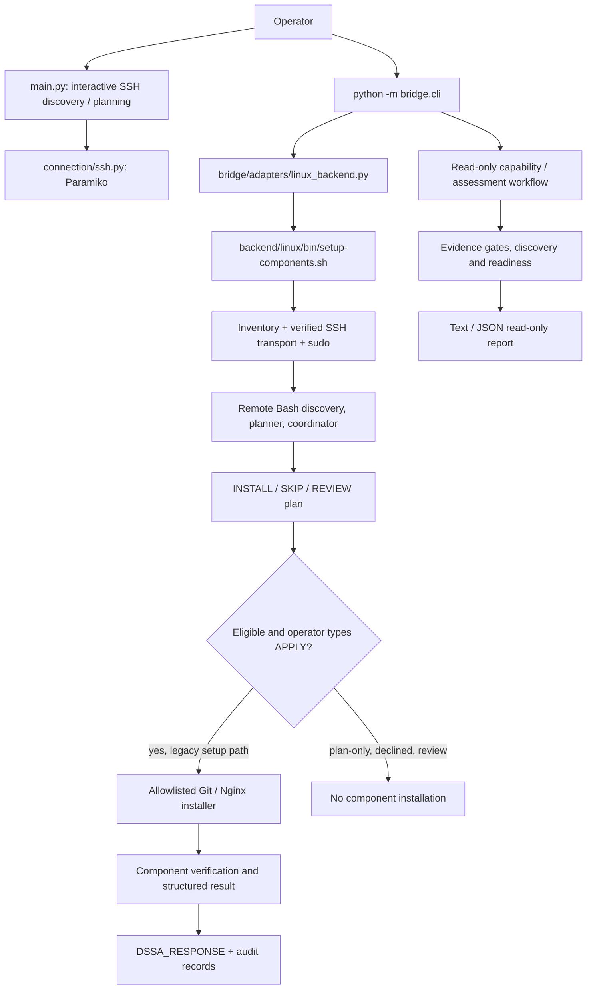

# Developer Server Setup Assistant (DSSA)

Agentless Linux server discovery, readiness assessment and selectively approved component setup, developed as a DevOps engineering project. **V1 is unfinished and is not recommended for production use.**

> **Source-of-truth snapshot:** published `architecture/layered-platform` commit `46f8637339255b8b2fac1e3a6a2e1f72071197cd` (12 November 2026). The operator's subsequent, uncommitted Milestone 4.29 Docker work is separately documented in [PROJECT_STATE](docs/PROJECT_STATE.md), not represented as published application code.

## Problem and intended use
Developers often receive a bare Linux server but need system discovery, SSH/sudo verification, conflict-aware component preparation, swap assessment and deployment readiness before deploying their own applications. DSSA aims to guide that work without deploying the application itself.

## What is verified today?

| Capability | Evidence / boundary |
|---|---|
| Agentless SSH connection, sudo and system discovery | Implemented in the Python interactive flow and Linux backend; lab and break/fix exercises documented |
| OS/kernel/CPU/RAM/disk/swap, panel and component discovery | Implemented; aaPanel detection demonstrated in lab |
| Read-only lifecycle and Docker/Compose assessment | Published through Milestones 4.10–4.27; 523/523 tests at 4.27 and 24/24 six-VM assessment checks |
| Package-manager-first Git setup | **Live installed** on Debian 13 (APT, Git 2.47.3) and AlmaLinux 10 (DNF, Git 2.52.0), with second-run SKIP and verification; 533/533 tests at 4.28 |
| Existing Nginx handling | Earlier live checks of installed-package and HTTP readiness; **fresh Nginx installation not established as validated** |
| Docker Engine installation | Published read-only draft recipe only. A separate *uncommitted* Ubuntu 24.04 Bash installer is being tested; **not installed live through DSSA** |
| Docker Compose installation | Read-only draft and runtime detection; no approved live installation |
| Swap creation/activation | Not verified as a completed end-to-end execution workflow |
| Panels such as CyberPanel/HestiaCP | Future work, not functional installers |

The application catalog includes 23 definitions. A catalog entry or draft recipe **does not** mean it is installable.

## Actual architecture



The read-only assessment workflow cannot authorize the legacy installation runner. The diagram reflects the **published** branch; unpublished Docker modifications are documented separately.

## Repository entry points

- `main.py`: interactive SSH, discovery, compatibility and non-executable approval demonstration.
- `bridge/cli.py`: `--target ... --component ... [--plan]`, `assess` and `capabilities` CLI routes.
- `bridge/adapters/linux_backend.py`: bridges component CLI to the backend runner.
- `backend/linux/bin/setup-components.sh`: inventory-backed SSH transport, remote bundle, audit and framed response.
- `backend/linux/planning/components.sh`: fixed component mapping, `INSTALL`/`SKIP`/`REVIEW` planning.
- `backend/linux/operations/setup.sh`: plan display, `APPLY` gate, execution dispatch, result validation and partial failure reporting.
- `backend/linux/modules/install/`: Git/Nginx component-specific installation helpers.
- `backend/linux/verification/`: Git/Nginx checks.
- `bridge/applications/`: application definitions, evidence, draft recipes and read-only readiness.
- `tests/backend/`: unit, contract, transport, planning and regression tests.
- `docs/`: detailed architecture, requirements, testing, troubleshooting, decisions and continuation state.

## Supported platforms: separate planning from installation

Read-only assessments and lab discovery have been exercised against Ubuntu 22.04/24.04/26.04, Debian 13, AlmaLinux 10 and Rocky Linux 10. That **does not imply universal installation support**.

- **Git:** live APT installation validated on Debian 13; live DNF installation validated on AlmaLinux 10; existing Git detection exercised on Ubuntu.
- **Nginx:** existing-install checks and Ubuntu 24.04 readiness exercised; fresh installation evidence incomplete.
- **Docker:** published recipes describe Ubuntu 24.04 x86_64 only and remain non-executable; active local Milestone 4.29 installer work is not merged.
- **Docker Compose, swap and control panels:** not established as live installer support.

## Reproducing a development checkout

**Developer workstation, ordinary user** (Ubuntu/Linux with Python 3, Bash and Git):

```bash
git clone git@github.com:vsm524565/developer-server-setup-assistant.git
cd developer-server-setup-assistant
git switch architecture/layered-platform
python3 -m venv .venv
source .venv/bin/activate
python -m pip install -r requirements.txt
```

The repository pins Python dependencies in `requirements.txt` (including Paramiko). System tools used by the backend include Bash, SSH/OpenSSH client, `jq`, `base64` and `sha256sum`; specific operations may also require other system utilities. Use supported distribution packages to install missing workstation prerequisites. Do not copy private keys or production inventory into Git.

**Developer workstation, ordinary user** — set up a private inventory using the repository's actual inventory schema and an SSH identity already authorized on the disposable target. The examples below assume that the local operator has configured `DSSA_INVENTORY_FILE`, `DSSA_SSH_KEY` and known-hosts entries; the six-VM inventory is not published as a reusable secret-bearing configuration:

```bash
export DSSA_INVENTORY_FILE="$HOME/.config/dssa/lab-inventory.json"
export DSSA_SSH_KEY="$HOME/.ssh/your-lab-key"
test -r "$DSSA_INVENTORY_FILE"
test -r "$DSSA_SSH_KEY"
```

Create a private inventory from [config/inventory/servers.example.json](config/inventory/servers.example.json), replace its placeholders with the authorized disposable host and lab user, store it outside the Git checkout, and run `chmod 600` on that private file. The example paths are not files guaranteed in a fresh clone. See [INSTALLATION](docs/INSTALLATION.md) for the safest reproduction sequence.

## Running DSSA

**Developer workstation, ordinary user, network/SSH access required:**

```bash
python main.py
python -m bridge.cli capabilities
python -m bridge.cli assess docker --target ubuntu24 --format text
python -m bridge.cli assess docker_compose --target ubuntu24 --format json
python -m bridge.cli --target ubuntu24 --component git --plan
```

The `assess` commands are read-only reports; `--plan` performs read-only component planning. A successfully generated report may legitimately say `REVIEW_REQUIRED` or `eligible:false`.

**Privileged target changes:** `python -m bridge.cli --target <lab-id> --component git` uses the **legacy Bash setup runner**, which displays a plan and requires an interactive `APPLY` on the target session. Use it **only on an authorized disposable lab server** after reviewing the exact plan and preserving recovery options. Never assume this setup path is governed by the newer read-only Python recipe system.

## Results and failure reporting

The runner emits a framed `DSSA_RESPONSE` JSON object. Approved successes record per-component `package_action`, `verification`, and `service_action`. Failure frames record `status:error`, completed steps, a failed step with unknown partial-change state, remaining `not_attempted` steps and `COMPONENT_FAILED` evidence. Nonzero backend exit status must not be silently converted into success.

## Non-destructive tests

**Developer workstation, ordinary user:**

```bash
env -u DSSA_INVENTORY_FILE -u DSSA_SSH_KEY \
  python -m unittest discover -s tests/backend -p 'test_*.py' -q
git diff --check
```

The published Milestone 4.28 regression passed **533/533**. During the unpublished Docker Milestone 4.29, the operator separately reported **554/554** before four new failure-path tests; do not describe these as published or fully passing. See [TESTING](docs/TESTING.md).

## Security, limitations and continuation

- Strict SSH host-key verification must remain enabled. Never embed passwords, SSH private keys, local inventory details or live server IPs.
- `APPLY` is interactive approval in the legacy runner; it is **not** a cryptographically bound, durable authorization for the draft recipe framework.
- An installation failure can leave packages, repositories or services partially changed; no automatic rollback guarantee exists.
- Docker daemon availability is **not** established by passive Docker readiness.
- Swap, Docker Compose installation, Docker Engine installation and full V1 end-to-end deployment readiness are incomplete.
- The latest local Docker work must be reconciled with this published-source snapshot before future commits.

**Engineering continuation:** [PROJECT_STATE](docs/PROJECT_STATE.md) · [ARCHITECTURE](docs/ARCHITECTURE.md) · [REQUIREMENTS](docs/REQUIREMENTS.md) · [ROADMAP](docs/ROADMAP.md) · [TESTING](docs/TESTING.md) · [TROUBLESHOOTING](docs/TROUBLESHOOTING.md) · [DECISIONS](docs/DECISIONS.md).

Project engineering convention: *Detect → Decide → Change → Verify*. Only move a capability to completed after implementation, relevant regression and observed integration evidence agree.


## Complete setup checklist and configuration reference

All instructions in this section run on the **developer workstation as an ordinary non-root user**, unless explicitly labeled otherwise.

1. Install workstation prerequisites (Python 3 with `venv`, Git, Bash, OpenSSH client, `jq`) using your workstation's supported package manager. This document does not pin system package versions, because the project has not validated a specific set.
2. Clone the existing repository, select `architecture/layered-platform`, create `.venv`, and install `requirements.txt` using the preceding development checkout instructions.
3. Inspect [config/inventory/servers.example.json](config/inventory/servers.example.json) and make a **private copy outside the repository**. Update only `host`, `ssh_user`, `ssh_port` and `target_id` for your authorized lab. Do not use production credentials.
4. Verify the target's host-key fingerprint out of band and put the approved key in `~/.ssh/known_hosts`. Configure `DSSA_SSH_KEY` to point to the approved **private key** and `DSSA_INVENTORY_FILE` to the private inventory. Do not set `StrictHostKeyChecking=no`.
5. Run the offline capabilities command, read-only assessment, and component `--plan` commands. Review every result, especially `eligible`, component action and reasons.
6. Only on an explicitly authorized disposable lab VM, if the plan and expected changes match, run the **separate legacy component setup command** and type `APPLY` on the interactive target prompt. This can change packages/services on the **target under sudo/root**; no workstation root permissions are intended. No Docker/Compose apply-mode operation is documented as verified.
7. Independently inspect the target's package and application health, then repeat plan-only discovery to confirm stable `SKIP` behavior before marking a component complete. Preserve both pre- and post-operation evidence.

### Configuration and sensitive files

| Path / variable | Meaning | Security |
|---|---|---|
| `requirements.txt` | Python pinned dependencies, including `paramiko==5.0.0` | Committed |
| `config/inventory/servers.example.json` | Sanitized inventory schema with lab placeholders | Safe to commit |
| `config/inventory/servers.json` | Tracked **sanitized example** in documentation branch; original developer branch may contain older lab details | Treat as example, not secrets storage |
| `DSSA_INVENTORY_FILE` | Absolute path to private JSON with `schema_version:1.0`, `servers`, target ID, platform, host, SSH port/user, enabled | Outside repository, mode `600` |
| `DSSA_SSH_KEY` | Path to authorized SSH private key | Outside repository, restrictive permissions |
| `$HOME/.ssh/known_hosts` | Approved SSH host keys | Verify out of band |
| `backend/linux/bin/setup-components.sh` | Local runner that bundles remote setup functions | Source code; do not invoke against production |
| `backend/linux/operations/setup.sh` | Remote plan approval, component coordination and structured results | Runs under target privileges |
| `backend/linux/modules/install/git.sh` | Installed/missing Git handling with APT/DNF | Target-side package changes only after `APPLY` |
| `backend/linux/modules/install/nginx.sh` | Nginx installer with package/config/readiness checks | Fresh installation not fully validated |
| `backend/linux/modules/install/docker.sh` | **Uncommitted workstation-only** Docker installer | Not safe/verified to execute |

### Ports and service endpoints

DSSA is an SSH-driven command-line tool. There is **no dedicated DSSA listening port** or web/API service in the published setup.

| Endpoint | Observed purpose |
|---|---|
| SSH TCP `22` | Default example target SSH port; inventory can specify another validated port |
| TCP `80`, `443` | Nginx port-conflict detection and HTTP(S) readiness considerations; **not** guaranteed open by DSSA |
| `/run/docker.sock` | Conventional rootful Docker Unix socket observed passively by read-only assessment; no Docker API connection established by that check |
| `docker.service` / `docker.socket` | Systemd units inspected read-only for Docker presence and state; they may be missing |
| `nginx.service` | Nginx target-side service checked/started by its existing installation workflow, when authorized |
| Git | CLI binary; **no service or network listening port** |

### Health checks and expected results

**Developer workstation, ordinary user — read-only:**

```bash
python -m bridge.cli capabilities
python -m bridge.cli assess docker --target lab-ubuntu-01 --format text
python -m bridge.cli assess docker_compose --target lab-ubuntu-01 --format json
python -m bridge.cli --target lab-ubuntu-01 --component git --plan
```

Replace `lab-ubuntu-01` with the configured local inventory target ID. An expected successful Git plan returns a single `SKIP` if Git is package-managed and installed or `INSTALL` if missing and eligible; `REVIEW` is a valid conservative outcome. Docker readiness may remain `REVIEW_REQUIRED` because passive observations do not establish daemon API health.

**Target VM, via authorized SSH session (read-only commands executed as the ordinary target user):**

```bash
git --version
command -v git
```

For APT package ownership (Debian/Ubuntu VM):

```bash
dpkg-query -s git | grep -E '^(Package|Status|Version):'
dpkg -S "$(command -v git)"
```

For DNF/RPM package ownership (AlmaLinux VM):

```bash
rpm -q git
rpm -qf "$(command -v git)"
```

Historical observed examples: Debian 13 Git 2.47.3 owned by `git`; AlmaLinux 10 Git 2.52.0 with executable owned by `git-core`. These versions are **evidence from specific lab snapshots**, not versions that the installer guarantees.

For Docker, **do not equate** `docker --version`, `docker.service` or the socket's existence with verified daemon readiness; active daemon and API health testing after approved installation remains pending.

### Backup, rollback and interrupted installation

No automated transactional rollback or backup mechanism was established for the published component setup runner. For disposable lab tests, select a VM with a known recovery path and capture the current package/service/configuration state before authorizing changes. A snapshot may be useful when available, but was not a mandatory recorded step in successful Git experiments.

When the setup fails, retain the exact `DSSA_RESPONSE`, exit code and sanitized logs; **do not automatically rerun**. Inspect package installation status, existing repositories, binaries and services, then recover manually according to the host's package manager and actual observed state. Docker installer failures may leave `/etc/apt/sources.list.d/docker.sources` and `/etc/apt/keyrings/docker.asc` or partially installed Docker packages (in the currently uncommitted local implementation); cleanup and rollback have not been tested. Do not delete container data or overwrite existing configuration to force a retry.

Refer to [TROUBLESHOOTING](docs/TROUBLESHOOTING.md) and [PROJECT_STATE](docs/PROJECT_STATE.md) for observed failure causes and the next verified checkpoint.

### Repository visibility and history

The project repository is currently **public** on GitHub. A separate documentation branch retains the existing Git history. Sanitizing current example files does **not** remove secrets or lab identifiers from earlier commits. Before distributing the repository, review Git history and make the repository private through an authorized GitHub settings/API workflow; neither a new duplicate repository nor a history rewrite is part of the documented setup.
