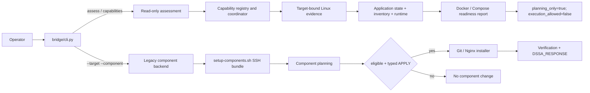
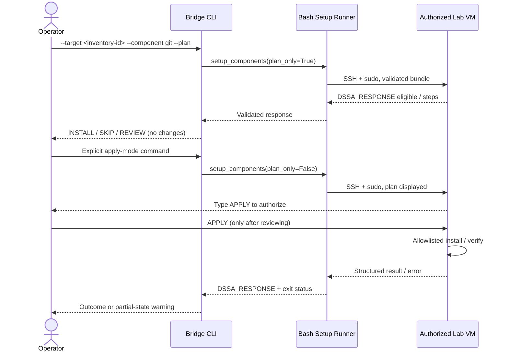

# Architecture — published implementation and development boundary

**Snapshot:** `architecture/layered-platform` at `46f8637339255b8b2fac1e3a6a2e1f72071197cd`, plus explicitly marked uncommitted history through 2026-11-14.

## Design principle

**Detect → Decide → Change → Verify.** DSSA is an agentless Linux operations assistant, not a developer-application deployment platform. Python handles user interaction, workflow and evidence validation. The central Linux Bash backend owns inventory-based SSH transport and the allowlisted privileged component setup path. No permanent target agent is required.

## Two intentionally separate workflows

These flows are **not interchangeable**. `bridge/applications/installation/recipes/` contains draft descriptions, **not** an execution API. The approval binding demonstrated by `main.py` does not independently authorize remote install operations.

## Layer responsibilities

| Layer | Actual published modules | Responsibilities |
|---|---|---|
| Interactive UI | `main.py` | Host/port/user/password via input/getpass, interactive SSH, discovery, snapshots, dependency and preflight planning, non-executable plan approval demonstration |
| Paramiko transport | `connection/ssh.py` | Connection/authentication, sudo checking, host-key validation, remote command results |
| Public CLI | `bridge/cli.py`, `bridge/assessment_cli.py`, `bridge/capability_cli.py` | Legacy component CLI, deterministic read-only Docker/Compose reports, offline capabilities |
| Bridge | `bridge/adapters/linux_backend.py` | Inventory-backed dispatcher calls, response schema and identity validation, legacy setup subprocess, framed output and error handling |
| SSH transport / inventory | `backend/linux/connection/inventory.sh`, `backend/linux/connection/ssh.sh`, `backend/linux/bin/dispatcher.sh`, `backend/linux/bin/setup-components.sh` | Validate inventory target, key/known-hosts policy, transport, bundled remote Bash, operation audit |
| Linux discovery | `backend/linux/discovery/`, `backend/linux/modules/software/` | System, panels, ports, packages, application inventory and runtime; passive Docker service/socket observations |
| Python assessment | `bridge/applications/`, `bridge/evidence/`, `bridge/workflows/` | Registry and draft recipe validation, target identity, evidence freshness, readiness reconciliation and report rendering |
| Bash planning | `backend/linux/planning/components.sh` | Published package-owned Git/Nginx mapping; eligible `INSTALL`/`SKIP`, blocked `REVIEW`, deduplicated plan |
| Bash setup | `backend/linux/operations/setup.sh`, `backend/linux/modules/install/` | Allowlisted plan approval, serial component setup, results and structured failures |
| Bash verification | `backend/linux/verification/` | Post-install or existing-state checks (application-specific) |

### Transport boundaries

The published runner validates each selection before resolving inventory. `inventory.sh` rejects invalid target IDs, unsafe/symlink/group-writable inventory files, missing/duplicated targets, and disabled/non-Linux targets. SSH host keys must be known and verified. Secrets and private keys must never be included in repository documentation.

## Application architecture and status

- **Git:** published APT/DNF recipe descriptions and separate executable Bash installer; live Debian 13 and AlmaLinux 10 success + repeat-run idempotency.
- **Nginx:** published Bash installer with panel and ports policy, config validation and readiness check; existing-package path and local HTTP demonstrated, fresh-install completeness not established.
- **Docker Engine:** published *draft* Ubuntu 24.04 vendor-repo recipe + nine-source read-only assessment. Working-tree **uncommitted** installer for Ubuntu 24.04 under Milestone 4.29; no live install evidence.
- **Docker Compose:** published *draft* Ubuntu 24.04 plugin recipe, Docker dependency and eight-source read-only assessment. No installation.
- **Swap:** discovery, safe planning and tests exist in parts of project; creation and activation not validated end to end.
- **Control panels:** aaPanel discovery demonstrated; Hestia/CyberPanel installers are future architecture work, not published workflows.

## Evidence, identity, and state safety

The read-only assessment dispatcher collects typed discovery data and uses target-bound, request-bound, freshness-checked evidence. Docker API responsiveness is not established by Docker CLI presence, systemd unit state, or passive socket/process status. The CLI intentionally presents `REVIEW_REQUIRED` when evidence is insufficient.

The legacy component runner relies on a displayed in-memory plan and a typed `APPLY`; it does not provide atomic transactions, automatic rollback or the same evidence-bound authorization as the Python read-only architecture.

Errors use a single `DSSA_RESPONSE` frame with `schema_version:1.0`, results and errors. The setup coordinator retains completed outcomes, labels a failure's package/service status conservatively, marks later steps not attempted and propagates a nonzero exit code. The Python bridge rejects malformed or unexpected response framing and component identity/order.

## Future extension rule

Finish and verify **one functional application** before generalizing the installer. The current order is Git (complete) → Docker Engine Ubuntu 24.04 (in progress) → Docker Compose (future). Do not treat a draft recipe's `expected_operations` as executable. New installers should plug into existing allowlists, discovery, planning, approval and structured result paths only after test coverage.

See [PROJECT_STATE](PROJECT_STATE.md) for precise outstanding work and [TESTING](TESTING.md) for evidence provenance.
