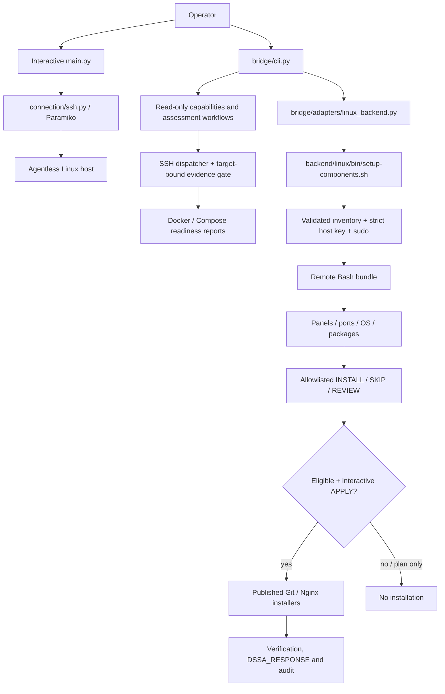

# PROJECT_STATE — Engineering continuation checkpoint

**Updated:** 2026-11-14  
**Repository:** https://github.com/vsm524565/developer-server-setup-assistant  
**Default branch:** `main`  
**Development branch:** `architecture/layered-platform`  
**Last independently confirmed published development commit:** `46f8637339255b8b2fac1e3a6a2e1f72071197cd` (Milestone 4.28).  
**Documentation work branch:** `docs/engineering-history-20261114` (created at that published commit).  
**Active operator workstation milestone:** **4.29 — Docker Engine Ubuntu 24.04 APT installation, not completed**.

## Branch and evidence boundaries

This checkpoint is reconstructed from the published GitHub branch and the operator's recorded terminal results. The local workstation checkout `~/projects/developer-server-setup-assistant` is **not mounted into the documentation environment**. The Docker Milestone 4.29 source files and test results described below were supplied in conversation and **are not present in the verified published GitHub commit**. Do not treat these as committed. Reconcile local files before rebasing, merging, cherry-picking, staging or publishing documentation into the active workstation branch.

The operator reported local, **uncommitted** modifications in:
- `backend/linux/bin/setup-components.sh`
- `backend/linux/operations/setup.sh`
- `backend/linux/planning/components.sh`

And new, **untracked** milestone files:
- `backend/linux/modules/install/docker.sh`
- `backend/linux/verification/docker.sh`
- `tests/backend/test_docker_planner.py`
- `tests/backend/test_docker_planner_dispatch.py`
- `tests/backend/test_docker_verification.py`
- `tests/backend/test_docker_installer.py`
- `tests/backend/test_docker_install_failures.py` (failure-injection suite, tests not yet confirmed all passing)

**Unrelated untracked files that must not be staged:**
- `.venv-pre-upgrade-backup/`
- `config/inventory/lab-six.json.bak`
- `planning/execution_readiness.py`

Any additional local changes after the last recorded `git status` are unknown. Do not overwrite this working tree.

## Architecture — actual implementation



### Responsibilities and security boundaries

- `main.py`: interactive IP/host, port, sudo username, password collection (getpass), Paramiko-backed discovery, snapshots, preflight and *non-executing* plan binding.
- `connection/ssh.py`: Paramiko SSH transport for interactive workflow. Do not relax host-key verification.
- `bridge/cli.py`: public component setup CLI and `assess`/`capabilities` subcommands.
- `bridge/adapters/linux_backend.py`: dispatcher requests and legacy setup response framing, ordered component result validation and backend exit checking.
- `backend/linux/connection/inventory.sh`: inventory must be a regular non-symlink file, non-group/other-writable, with a unique enabled Linux target and validated connection fields.
- `backend/linux/bin/setup-components.sh`: SSH execution bundle, audit identifiers/digest and response framing.
- `backend/linux/planning/components.sh`: published Git/Nginx plan eligibility, fixed package mappings, deduplication and `INSTALL`/`SKIP`/`REVIEW` decisions.
- `backend/linux/operations/setup.sh`: operator types `APPLY` after seeing eligible plan; component ordering, `install_git`/`install_nginx` dispatch, structured partial failures.
- `bridge/applications/`: 23 application catalog entries, read-only installation recipes, evidence reconciliation, Docker/Compose workflow handlers and reporting. **No execution authorization here.**
- `backend/linux/modules/install/git.sh`: APT/DNF Git install, check and idempotency; live validated.
- `backend/linux/modules/install/nginx.sh`: Nginx checks and installer; existing installation behavior validated, fresh path not yet fully validated.
- `backend/linux/verification/git.sh`: binary-level Git version verification.
- Docker production installer/verifier in the operator's working tree: **not included in published source**.

There is no durable integration between Python draft recipe eligibility and legacy Bash `APPLY`. No automatic rollback is guaranteed.

## Completed milestones (verified evidence)

| Milestone | Evidence |
|---|---|
| Project foundation / original discovery | Python SSH/sudo/OS/resources/panel discovery and negative lab cases; implementation exists; not all legacy checklist fields audited |
| Backend discovery and component coordination | Six-VM Linux lab demonstrations, structured response and failure regressions |
| 4.10–4.27 read-only architecture | Published Docker (nine-source) and Compose (eight-source) workflows; 523/523 tests and 24/24 six-VM text/JSON CLI assessments at 4.27 |
| 4.28 Git installation | Published `46f8637`; **533/533 backend tests**. Fresh Git installed on Debian 13 with APT (2.47.3) and AlmaLinux 10 with DNF (2.52.0); repeat-run `SKIP` + verification passed, package ownership checked |

Historical `docs/ROADMAP.md` contains some old unchecked boxes and stale `pending` statements. They are not authoritative over newer evidence. Read sections chronologically and use this checkpoint for current state.

## Current milestone 4.29 — Docker installation: what has been observed

Intended platform: **Ubuntu 24.04 (Noble), x86_64 / amd64**, vendor APT repository; Engine first, Compose later.

1. Initial Ubuntu 24 lab preflight: Docker packages, executable, repository and Docker data directories not detected; approximately 20 GiB disk available. Server **not modified by Docker installation**.
2. Initial Docker generic planner dispatch bug: six VMs incorrectly returned eligible `INSTALL`. Fixed in **local uncommitted** `components.sh`, plus permanent dispatch test.
3. Final six-VM plan result: Ubuntu 24 = `INSTALL`, eligible; Ubuntu 22/26, Debian 13, AlmaLinux 10 and Rocky 10 = `REVIEW`, ineligible.
4. Local Docker scripts created: conservative conflict and partial-state detection, vendor signing-key fingerprint checks, repository setup, package install, daemon readiness and repeat verification. **No real Docker installation has been performed.**
5. Local suite results:
   - `test_docker_planner.py`: 7 passed
   - `test_docker_planner_dispatch.py`: 1 passed
   - `test_docker_verification.py`: 5 passed
   - `test_docker_installer.py`: 8 passed
   - Complete regression **554/554 passed** prior to the four additional failure-injection tests, on 2026-11-13.
6. `test_docker_install_failures.py` initially had four failures from fixture errors, later 3/4 passed; the fourth was traced to accidentally reversed first/second APT-update failure messages in local `docker.sh`. The latest assistant instructed swapping the messages back and rerunning. **No subsequent passing output was provided.** Treat four-test outcome as pending.
7. A temporary diagnostic in the test mock (`MOCK_APT`) was added during troubleshooting and should be removed after the issue is resolved.

### Current blocking issues, in priority order

- **Fix/verify initial vs second `apt-get update` error reporting.** First update before Docker repository setup must say `APT metadata refresh failed.`; second after repository configuration must report possible partial state.
- **Re-run all four `test_docker_install_failures.py` tests** and inspect failures without weakening installer safeguards.
- **Strengthen isolated test harness**: mocking a few shell functions does not guarantee complete process/filesystem isolation; do not run later-stage failure injection until unexpected commands cannot reach real package managers, services or host directories. Use an isolated container/VM or hard command whitelisting and a fully redirected synthetic filesystem.
- **After-repository failures**: second metadata update, Docker package installation, service startup, post-install API verification and coordinator `COMPONENT_FAILED` result propagation still need permanent tests.
- Existing source-state risk: drafted Docker installer and planner are duplicated in independently maintained paths; check that their platform/package and repository conflict policies agree.
- No live Docker Engine install, Docker Compose install, or idempotency evidence yet.

## Exact next development action

**On the operator's workstation; no remote change required:**

```bash
cd ~/projects/developer-server-setup-assistant
grep -n -A 1 'apt-get update' backend/linux/modules/install/docker.sh
bash -n backend/linux/modules/install/docker.sh
python -m unittest discover -s tests/backend -p 'test_docker_install_failures.py' -v
git diff --check
git status --short
```

Expected first update: `APT metadata refresh failed.`; second update: `Docker repository metadata refresh failed; partial repository configuration remains.`

If all four pass, investigate post-repository failure simulations under a truly isolated harness. **Do not run `python -m bridge.cli --target ubuntu24 --component docker` without `--plan` yet.**

### Acceptance before marking 4.29 complete

- All Docker planner, installer, daemon-verification and coordinator tests pass.
- Full backend regression passes after final fixture changes; record exact count.
- All Bash syntax and Python compilation checks pass.
- Six-VM unsupported-platform guard remains correct.
- Current Docker source and test harness reviewed for filesystem/host safety.
- Approved live disposable Ubuntu 24 installation tested with explicit `APPLY`, followed by package ownership, Docker daemon API health and repeat-run SKIP checks.
- Compose remains a separate future milestone.
- Stage only intended files; security review; commit/push existing development branch and compare local vs GitHub SHA.

## Test reproduction and current evidence

**Workstation, ordinary user:**
```bash
env -u DSSA_INVENTORY_FILE -u DSSA_SSH_KEY \
  python -m unittest discover -s tests/backend -p 'test_*.py' -q
python -m unittest discover -s tests/backend -p 'test_docker_install_failures.py' -v
git diff --check
```

Published baseline 533 passed. Uncommitted working tree baseline 554 passed before newer fixture changes. **Tests in this documentation environment not executed**, because the user's local checkout/VM inventory is unavailable and the GitHub connector exposes published files only.

## Engineering conventions and non-goals

- Work on one executable application at a time; finish Docker Engine before Compose.
- Bash is the agentless Linux execution backend; Python is the interface, assessment and evidence bridge.
- Preserve function-level comments and clear component boundaries.
- Never call read-only DRAFT recipes executable or infer Docker API health from passive socket/process status.
- Require strict SSH host-key checking, validated target inventory and explicit approval for mutations.
- Return structured errors and preserve partial changes for investigation; avoid automatic retry or cleanup.
- Use Git identity `vsm524565` / `vsm524565@gmail.com` in the local repo only when the operator publishes.
- Do not change repository visibility, default branch, source implementation, SSH credentials or production servers during documentation work.
- Do not stage the unrelated paths listed above.

**Companion references:** [README](../README.md) · [ARCHITECTURE](ARCHITECTURE.md) · [ROADMAP](ROADMAP.md) · [TESTING](TESTING.md) · [TROUBLESHOOTING](TROUBLESHOOTING.md) · [DECISIONS](DECISIONS.md).
